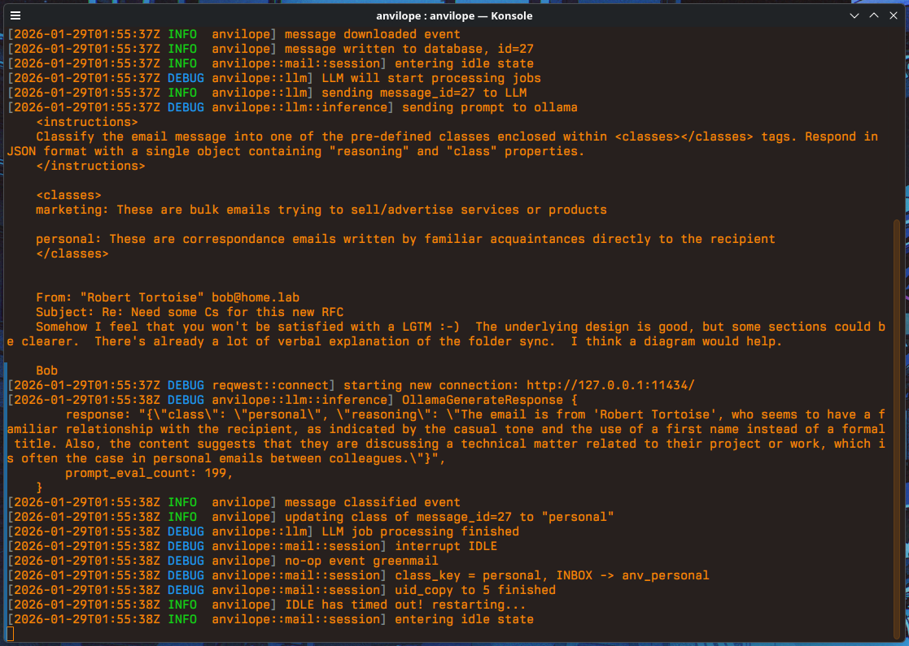

Anvilope
========

_A heavy-handed approach to email_

Anvilope is an email classification daemon. It listens over IMAP for incoming
email messages and processes them with a self-hosted LLM. The classification
prompt as well as what model to use are all user customizable.

The vision of this project is to create a more flexible version of Google's
inbox categories that can be used with any email service.

#### Some Highlights
+ Written in Rust
+ Llama.cpp or Ollama for inference
+ Customize your own classes
+ Specify destination folders for each class

#### What it looks like


Status
------
This project is in active development and should be considered early alpha
quality. Happy path functionality works, but there are still sharp edges and
excess bits to be removed! It may crash after running for a few hours, or it may
even set fire to your crops. You've been warned!

More seriously, the format of the configuration file and the database schema are
still in flux. Manual intervention may be needed when updating from one version
to another. When in doubt one can delete the `~/.anvilope/anvilope.sqlite`
database and start over without serious consequences.

(Note: The `anvilope.sqlite` file currently stores clear text copies of all
incoming emails for debugging purposes. Please don't use Anvilope at this time
if this poses a security problem.)

Install
-------

#### Requirements
+ Recent version of Rust
+ Llama.cpp's `llama-server` or `ollama` installed with one's model of choice
+ Email account accessible over IMAP

#### Build
The project should build fine with cargo:
```
cargo build
```

While testing things out it's convenient to run Anvilope directly from the
repository. One can see the available CLI commands with:
```
cargo run help
```

If desired, installing the executable to cargo's bin directory follows a normal
process as well:
```
cargo install --path .
```

After confirming that Anvilope builds and runs, the next step is to provide a
configuration file.

Configuration
-------------

Anvilope's configuration file is assumed to be present at
`$HOME/.anvilope/anvilope.toml`. The example configuration file from the
integration tests can be a good starting point and is located at
`tests/data/anvilope.toml`.

Changes will need to be made for:
+ The location of either `llama_cpp_host` or `ollama_host` and which `model` to
  use in the LLM section
+ The IMAP account information in the accounts section
+ Optionally, the IMAP account name to something more fitting than "greenmail"
+ Optionally, the `prompt` template and `classes` of each classifier in the
  classifiers section
+ Optionally, which classifiers each account runs and what actions to take when
  messages are classified into each class

#### Format

+ The `classifiers` section contains one or more named classifiers. Each
  classifier has a `prompt` template and a `classes` table mapping class names
  to short class prompt descriptions. Every message received on an account is
  run through each of that account's classifiers.
+ Each account lists the names of the classifiers to run on its messages with
  the `classifiers` key.
+ Each account may also define a list of `actions` to apply when a message is
  classified into a given class. The `if_class` property references a class as
  `<classifier name>.<class name>`. The only action type currently supported is
  `label`, which copies the message into the given IMAP folder (the `name`
  property).

An example of the accounts and classifiers sections:

```toml
[accounts]
gmail.host = "imap.gmail.com"
gmail.port = 993
gmail.username = "example_user@gmail.com"
gmail.password = "example_password"
gmail.classifiers = ["categories"]
gmail.actions = [
    { type = "label", name = "my_spam_folder", if_class = "categories.spam" },
    { type = "label", name = "my_personal_emails", if_class = "categories.personal" },
]

[classifiers.categories]
prompt = """..."""
classes.personal = "..."
classes.spam = "..."
```

#### IMAP Credentials
If credentials for an IMAP account are not specified in the configuration file
Anvilope will attempt to load them from environment variables instead.
Environment variable names depend on the account name used in the configuration
file.

For an account named "glitchmail" the following environment variables will be
used:
```
$ANV_CONFIG__ACCOUNTS__GLITCHMAIL__USERNAME
$ANV_CONFIG__ACCOUNTS__GLITCHMAIL__PASSWORD
```

#### Writing Prompts

##### Template Variables

Anvilope uses basic jinja templating to assemble its final prompts that get sent
to the LLM. Special variables are used to allow for customizing where different
pieces of content get inserted.

+ `{{ classes }}`: a list of class names and each class's sub-prompt as defined
+ in that classifier's `classes` table
+ `{{ email_message }}`: the content of the current incoming email message

##### Response Format

Anvilope's harness expects a specific JSON format on LLM responses. This simple
format is shown below:

```
{ "class": "...", "reasoning": "..." }
```

While Anvilope specifies that this format be enforced by the inference engine's
sampler, response quality will be better if the expected format is also
described to the model in the input prompt. Feel free to use the following brief
sentence in prompt instructions in lieu of something more advanced:

```
Respond in JSON format with a single object containing "reasoning" and "class"
properties.
```

#### Testing

Once the configuration file is ready Anvilope includes utilities for validating
the settings.

A dry run will load the configuration and complain if any required fields are
missing:
```
anvilope dryrun
```

A "damp run" will go a step further and connect to external services to ensure
that everything is hooked up correctly. It specifically attempts to connect to
any specified IMAP servers and also attempts to run a sample prompt through the
configured inference host:
```
anvilope damprun
```
